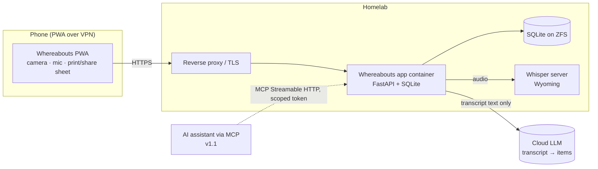
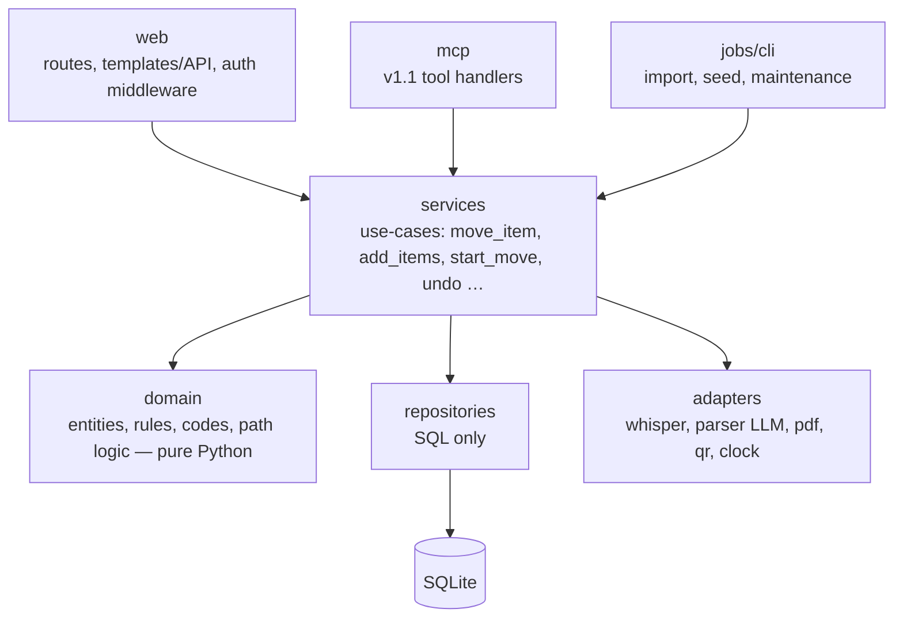
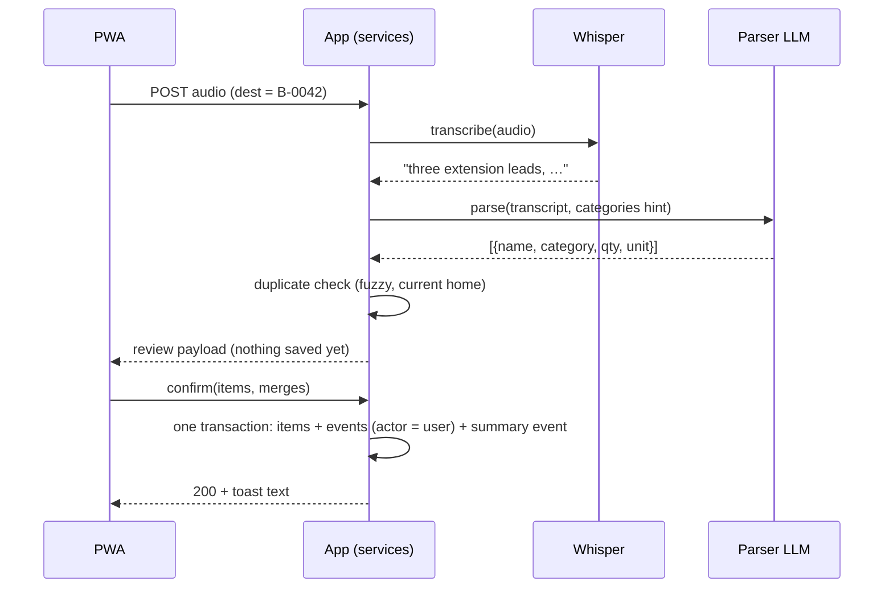

# Whereabouts — Architecture

> v1.0 · 31 October 2026 · **Starting draft for `docs/agents/architecture.md`.** The Architect's first issue is to adopt this into the repo, fill the gaps marked **[Architect]**, and keep it current. Jamie is architect of record: the Architect agent proposes, never decides.
> Decision records live in `decisions/`. Data model: `data-model.md` + `schema.sql`. Labels: `labels-and-printing.md`. MCP (v1.1): `mcp.md`.

## 1. System context



- **Audio never leaves the homelab.** Only the transcript text goes to the parsing model (D-09, D-10).
- No other outbound calls at runtime (no analytics, CDNs, fonts) — NFR-04.

## 2. Containers and runtime

| Piece | Choice | Status |
|---|---|---|
| Language | Python 3.12 | Settled (site uses 3.12; match it) |
| Web framework | **FastAPI** (ASGI, Uvicorn) | Settled (D-05). The *website* uses Starlette; that's a separate project |
| Database | **SQLite** (WAL mode), file on a ZFS dataset | Settled |
| Search | SQLite **FTS5** + fuzzy matching | Settled for v1; embeddings later |
| Frontend | **Open — ADR-0002** (Jinja + HTMX + Alpine.js proposed; SPA alternative) | Open |
| PWA | Web app manifest + service worker (app shell cache only; data stays live) | Settled |
| PDF generation | WeasyPrint or ReportLab, server-side, vector QR, embedded fonts | Engine open (O-12) |
| QR generation | Server-side vector (e.g. `segno`), encoding the `/c/<code>` URL | [Architect] pick library |
| QR scanning | In-browser camera decode (e.g. `BarcodeDetector` with JS fallback) | [Architect] |
| Speech-to-text | HTTP/Wyoming client to the household's Whisper server | Settled |
| Transcript parsing | Cloud LLM via configurable provider (OpenAI-compatible) | Provider open (O-05) |
| Auth | Passkeys vs OIDC — **ADR-0003**; test-only login behind `TEST_LOGIN=on` | Open (O-02) |
| Packaging | One container image `ghcr.io/simsjm/whereabouts:tree-<hash>`, non-root, health check, data in `/data` | Settled |

## 3. Layers and the rules that matter most



**Structural rules** (from the spec and pipeline; enforce in CI where possible):

1. **One service layer.** Web handlers and the MCP server both call the same service functions. **Neither touches the database directly.** (`import-linter` contract.)
2. **Every write is logged.** Every state change goes through a service that appends an event with an actor (user or agent) in the **same transaction**. (`event-log-coverage` test fails if any write path completes without an event.)
3. **No hard deletes.** No `DELETE` statements outside migrations/tests. Archive or quantity 0.
4. **Codes are never reused.** Allocated from a per-household, per-prefix counter; archived codes stay reserved.
5. **Domain is pure.** `domain` imports nothing from web, repositories or adapters.
6. **External services behind adapters** with fakes for tests (recorded audio + transcripts for Whisper; canned responses for the parser).
7. **"Location" is an internal word.** It may appear in code, API and MCP, never in UI copy.

Suggested `.importlinter` (Architect to finalise):

```ini
[importlinter]
root_package = whereabouts

[importlinter:contract:layers]
name = Layered architecture
type = layers
layers =
    whereabouts.web | whereabouts.mcp | whereabouts.jobs
    whereabouts.services
    whereabouts.repositories | whereabouts.adapters
    whereabouts.domain

[importlinter:contract:no-db-in-handlers]
name = Handlers never touch the database
type = forbidden
source_modules =
    whereabouts.web
    whereabouts.mcp
forbidden_modules =
    whereabouts.repositories
    sqlite3
```

## 4. Key flows

### 4.1 Add by voice (FR-VOI-02…06)



Parser contract: input transcript + optional category vocabulary; output strict JSON list; validate with a schema; on invalid output return a review screen with the raw transcript and zero parsed items, never guess.

### 4.2 Scan to open (FR-QR-01/02)

`GET /c/{code}` → auth → resolve code in the user's household → 302 to the Box or Place screen. Unknown → page with closest matches ("No box B-0043. Closest: B-0034 (Loft)"). Archived → "archived" page. Code lookup is case-insensitive.

### 4.3 Move house (FR-MOVE-*)

`start_move(from_home, day, new_home_name, rooms[], boxes{box_id: room_name})` in one transaction: create home + rooms, re-parent selected top-level boxes to destination rooms, set `move_state = packed`, write events. `unpack(box, room)` re-parents and sets `unpacked`. `finish_move()` clears `unpacked` flags (packed ones stay packed), closes the move, writes event.

### 4.4 Undo (FR-HIS-04)

Undo is a **new compensating event** produced from the target event's `before` state, applied through the normal service (so it is itself logged and attributable). Never mutate or delete history. Undo of an event whose subject is archived fails with "That item was archived".

## 5. Configuration (names provisional until the Architect settles them)

| Variable | Purpose | Example |
|---|---|---|
| `APP_ENV` | `dev` / `test` / `preview` / `production` | `preview` |
| `DATABASE_URL` | SQLite path | `sqlite:////data/whereabouts.db` |
| `SEED_FIXTURES` | Load `../quality/seed-fixtures.yaml` (`demo`) | `demo` |
| `TEST_LOGIN` | Test-only login; must refuse to start if `APP_ENV=production` | `on` |
| `PUBLIC_BASE_URL` | Used in QR URLs | `https://<app-host>` |
| `WHISPER_URL` | Whisper/Wyoming endpoint | `<private>` |
| `PARSER_PROVIDER`, `PARSER_MODEL`, `PARSER_API_KEY` | Transcript parser | `<private>` |
| `SESSION_SECRET` | Session signing | `<private>` |

Secrets and hostnames live only in private config on the host (never in the repo or public wiki).

## 6. Quality attributes

- **Safety of data:** WAL, transactions per use-case, ZFS snapshot before every deploy, migration rehearsal on a snapshot clone.
- **Testability:** deterministic clock adapter; fakes for every external call; seeded fixtures; `data-testid` contract (`../design/screen-inventory.md`).
- **Agent-readiness:** actors are `{type: user|agent, id, display_name}` from day one so MCP slots in without schema change.
- **Performance:** targets in NFR-09; indexes on `locations(household_id, parent_id)`, `items(location_id)`, FTS tables kept in sync by triggers.

## 7. Codebase navigation for agents (D-34)

- Keep this file and `data-model.md` current; Mermaid over images.
- Optional: an LSP-backed MCP (e.g. Serena) for definition/reference lookups; an auto-generated repo map (tree-sitter outline) regenerated by CI on merge. An outdated map is worse than none — the Architect owns freshness and any PR that changes structure must update this file.
- Open models on Ollama Cloud have smaller usable context, so keep docs concise.

## 8. [Architect] To complete

- Package layout and module names.
- Frontend stack (ADR-0002) and how the PWA shell, templates/components and tokens are organised.
- Auth (ADR-0003), sessions, CSRF.
- Migration tool (e.g. Alembic or plain numbered SQL) — `migrations/` is a high-risk path.
- Error model and API shape (if JSON API exists).
- Undo granularity for batch operations (import, voice add, start move).
