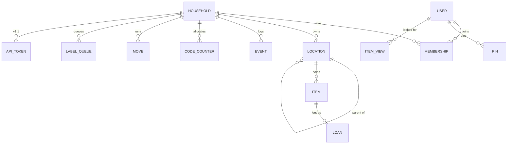

# Whereabouts — Data model

> v1.0 · 31 October 2026 · Decided 9 October 2026 (spec §3) plus additions implied by the MVP scope (moves, lending, pins, label queue). DDL draft: `schema.sql` (Architect to confirm; `migrations/` is Jamie's to merge).

## 1. Entities

### 1.1 Location tree — one table

`locations(id, household_id, parent_id, kind, name, label_code, move_state, archived_at, created_at, updated_at)`

| `kind` | Rank | Has code | Parent may be |
|---|---|---|---|
| `home` | 1 | No | — (null only for homes) |
| `room` | 2 | No | home |
| `place` | 3 | `P-0001` | room |
| `box` | 4 | `B-0001` | room, place, **or box** |

- **Ordering rule:** parent rank must be **lower** than the child's rank — levels may be skipped (box straight in a room), never inverted. The single exception: a **box's parent may be a box**. Only homes have no parent. No cycles.
- **"Location"** is internal only (D-12).
- **Multiple homes** per household; homes are tree roots.
- **Moving** a place/box = one `parent_id` change; contents follow.
- **Paths/breadcrumbs** via recursive CTE; a stored path can be added later if reads need it.
- **Labels** attach to any location except a home (place and box labels are one feature).
- `move_state`: `null` | `packed` | `unpacked` (boxes only; set during a move).

### 1.2 Items

`items(id, household_id, location_id, name, category, quantity, unit, tags, photo_ref, notes, archived_at, created_at, updated_at)`

- `location_id` must be a **room or deeper** — so every item has a home and a room; place and box optional.
- `quantity ≥ 0`. Quantity 0 ≠ archived.
- One item = one location in v1 (O-03 deferred).

### 1.3 Codes

- `code_counters(household_id, prefix, next_value)` with prefixes `B` and `P`.
- Format `<prefix>-<4+ digits>` zero-padded (`B-0042`); grows past 9999 naturally (`B-10000`).
- **Sequential, unique per household, never reused** — archived locations keep their code; the counter only increases.
- (The pipeline doc's `L-` prefix was an error: it's `P-`.)

### 1.4 Event log — append-only

`events(id, household_id, occurred_at, actor_type, actor_id, actor_name, verb, subject_type, subject_id, summary, before_json, after_json, undoes_event_id, batch_id, undone)`

- `actor_type`: `user` | `agent` (agents arrive with MCP; the Changes tab already shows them).
- Verbs (minimum): `item.added`, `item.moved`, `item.quantity_changed`, `item.updated`, `item.archived`, `item.lent`, `item.returned`, `location.created`, `location.moved`, `location.renamed`, `location.archived`, `label.printed`, `label.sheet_printed`, `import.completed`, `voice.added`, `move.started`, `move.box_packed`, `move.box_unpacked`, `move.finished`, `undo`.
- `summary` is the human line ("Moved to Toolbox"); `before_json`/`after_json` allow undo and "where was it last?".
- `batch_id` groups multi-row operations (import, voice add, start move) for batch display/undo.
- Never updated except the `undone` flag; never deleted.

### 1.5 Users and households

- `users(id, display_name, email, created_at)`; auth credentials in tables defined by ADR-0003.
- `households(id, name)`; `memberships(household_id, user_id, role)` with roles `admin`, `member` (`readonly` later).
- Every change attributed to a person (or agent).

### 1.6 Per-user lists

- `pins(user_id, item_id, created_at)` — **Pinned** tab (per-user assumed).
- `item_views(user_id, item_id, viewed_at)` — **Looked for** tab (latest 6 shown).
- `user_state(user_id, changes_seen_at)` — drives "changes by other people **since you last looked**".

### 1.7 Lending

`loans(id, item_id, lent_to, lent_since, due_on, returned_at)` — at most one open loan per item. Separate from the item's usual location.

### 1.8 Moves

`moves(id, household_id, from_home_id, to_home_id, moving_day, started_at, finished_at)` — at most one open move per household.

### 1.9 Label print queue and calibration

- `label_queue(household_id, location_id, added_at)` — cleared only on "Printed OK".
- `label_settings(household_id, offset_x_mm, offset_y_mm)` — 0.5 mm steps.

### 1.10 API tokens (v1.1, reserve now)

`api_tokens(id, household_id, user_id, name, scope, token_hash, created_at, last_used_at, revoked_at)` — scope `read` | `read_write`; agent acts as the user; token shown once.

## 2. Invariants to test

1. Inserting a room under a box, a place under a box, or anything under an item is rejected.
2. A box can contain a box; a cycle (A in B in A) is rejected.
3. An item on a home is rejected.
4. Every service write produces ≥ 1 event in the same transaction (`event-log-coverage`).
5. No code is ever issued twice for a household, including after archive.
6. Archiving a box with contents: **[Product/Architect]** decide — block, or archive contents too (with events). Default: block with "Empty or move the contents first".
7. Undo produces a new event and restores the `before` state.
8. Search never returns archived rows and is scoped to the current home.

## 3. Seed data

`../quality/seed-fixtures.yaml` mirrors the prototype's sample household (2 homes, 6 rooms, 9 places, 12 boxes, 42 items, 2 loans, 5 events) and is shared by regression tests and previews.
