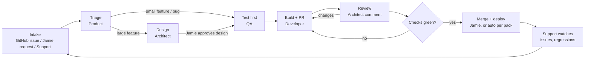

# The factory loop — how work flows

> v1.0 · 31 October 2026 · Every agent reads this before starting an issue. Adapted from the 6 Oct pipeline flows (archived) to Paperclip issues.

## 1. Issue types (title prefix)

| Prefix | Owner | Done when |
|---|---|---|
| `[DESIGN]` | Architect | Design note / ADR draft written and linked |
| `[TEST]` | QA | Failing acceptance tests pushed to the branch |
| `[REPRO]` | QA | A test reproducing the bug is pushed and fails on `main` |
| `[BUILD]` | Developer | PR open, Architect reviewed, all required checks green |
| `[MAINT]` | Developer | Maintenance PR (deps, CVEs, changelog, docs) checks green |
| `[SWEEP]` | Architect | Monthly sweep findings filed as proposal chains |

## 2. Flows

**Small feature:** `[TEST]` → `[BUILD]`. Product writes the head issue with spec + acceptance criteria (with `data-testid`s and requirement IDs) and leaves it **awaiting approval**. Jamie approves → QA writes tests on `feat/<issue>` → Developer makes them pass, opens the PR → Architect reviews → checks green → Jamie merges.

**Large feature** (adds/changes a DB table, adds a public endpoint or MCP tool, or is high-risk): `[DESIGN]` → `[TEST]` → `[BUILD]`. Jamie approves exploring it; Architect writes the design; **Jamie approves the design** before QA starts.

**Bug:** `[REPRO]` → `[BUILD]` on `fix/<issue>`. Confirmed bugs need **no approval**. If QA can't reproduce, it asks the reporter (via Support) and blocks the issue "cannot reproduce". Merge per risk tier.

**Refactor:** Architect proposes from its sweep with a decision record; `[TEST]` → `[BUILD]` on `refactor/<issue>`; Jamie approves and always merges.

**Security reports never become issues.** They arrive via private vulnerability reporting (`SECURITY.md`) and Jamie handles them.

## 3. Approval rule

Jamie approves a chain by approving (assigning/releasing) its head issue. **Agents never self-approve the head of a feature or refactor chain.** Verify in a dry run that unapproved issues are never picked up (factory-overview §8).

## 4. Handoffs

Each agent passes forward, in its completion summary/metadata:

- `issue` — the GitHub issue link (not its text)
- `requirements` — e.g. `FR-MOVE-06`
- `acceptance_criteria` — copied forward **unchanged** from the head issue
- `branch` — once QA has created it
- `pr` — once Developer has opened it

## 5. Escalations and follow-ups

- **Structural concern in review:** Architect blocks the issue with `architecture: …`; Jamie decides whether a `[DESIGN]` issue is needed.
- **Problem after done** (CI failure, deploy failure, regression): never reopen a done issue. Product creates a follow-up chain linked to it.
- **Anything irreversible or external** (repos, accounts, DNS, firewall, Caddy reloads, deleting anything, branch protection): stop and ask Jamie.

## 6. Scheduled work

- Architect **monthly sweep** (`[SWEEP]`, idempotency key `arch-sweep-YYYY-MM`): duplication, layer drift, growing complexity, stale docs/map.
- Developer **weekly maintenance** (`[MAINT]`, key `maint-YYYY-WW`): dependency updates, CVE checks, changelog, docs — via PR and review.
- Product **weekly backlog review**.
- All batch work off-peak (outside 12:00–18:00 UTC weekdays).
