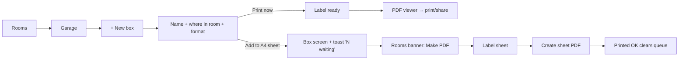
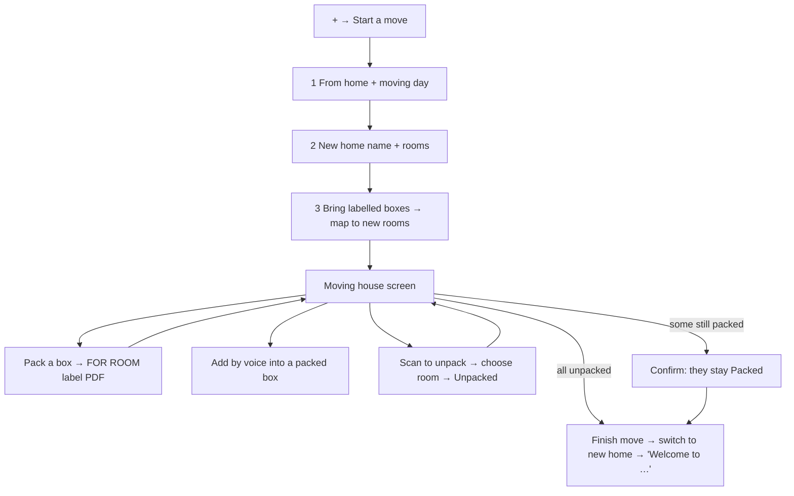

# Whereabouts — Key user journeys

> v1.0 · 31 October 2026. Each journey is a candidate end-to-end (Playwright) test. Requirement IDs in brackets. The clickable prototype (`../design/prototype/home-inventory-demo.html`) demonstrates all of them with sample data; its on-page notes list the same tour.

## J1. Find something by voice (FR-VOI-01, FR-SRCH-02)

1. Home → tap the accent mic beside "Where's…?".
2. Search screen shows LISTENING; user says "allen keys".
3. Whisper transcribes; query "allen keys" runs.
4. Result: **Allen key set** · `Garage › Shelf 2 › Toolbox` · Qty 1. Tap → item screen.

## J2. Undo something your partner moved (FR-HOME-02, FR-HIS-04)

1. Home → **Changes** tab (badge 3): "Picture hooks · Moved to Toolbox · Partner · 2h ago" with **Undo**.
2. Tap Undo → toast "Undone: Picture hooks is back in Drawer 1". History gains "Moved back to Drawer 1" by Jamie.
3. Agent changes (e.g. "AA batteries · Quantity set to 12 via MCP · Claude") also appear here (post-MVP actor type, but the list must already support non-user actors).

## J3. Create a box and its label (FR-LBL-01…05)

## J4. Add by voice into a box, merging a duplicate (FR-VOI-02…06)

1. Open box **Toolbox** → "Add by voice".
2. Say "Three extension leads, a cordless sander and a box of wall plugs".
3. Review: Extension lead ×3 (Electrical), Cordless sander ×1 (Power tools), Wall plugs (box) ×1 (Fixings) flagged "Already have these in Garage › Drawer unit › Drawer 1" → **Merge**.
4. "Add 3 items" → toast "3 items added to Toolbox"; the wall plugs quantity on Drawer 1 goes up by 1.

## J5. Move an item, then undo it (FR-ITM-05, FR-HIS-04)

Item → Move → picker grouped by room → choose destination → toast "Moved to …" → History → Undo.

## J6. Bulk import (FR-BLK-01…04)

+ → Bulk import → "Use the sample file" (`garage-shelves.csv`, 6 rows) → preview "5 new items, 1 merge, and a new Shelf 3 with a Car kit box" → Import 6 rows → lands on Garage; Shelf 3 and Car kit (B-0060) created.

## J7. Move house end to end (FR-MOVE-01…10)

## J8. Switch homes (FR-LOC-04)

Tap the home name → HOMES sheet (Main house · Cottage · New house…) → pick → toast "Switched to Cottage"; Rooms and search now scope to the Cottage.

## J9. Box inside a box (FR-LOC-03)

Rooms → Garage → Shelf 1 → Fishing crate (B-0055) → "BOXES INSIDE" → Tackle box (B-0056).

## J10. Lend and return (FR-LEND-01…03)

Item **Cordless drill** shows "Lent to Sam next door since Saturday" → Returned → toast "Cordless drill is back"; Lent out badge drops.

## J11. Scan a label (FR-QR-01…03)

Rail scan button → camera → FOUND · B-0042 · Toolbox · Garage · Opening… → box screen. Or phone camera on the printed label → `https://<app-host>/c/B-0042` → same box.

## J12. Calibrate labels (FR-LBL-08)

Account → Labels → Alignment test sheet (PDF) → print on plain paper, hold against a label sheet → adjust Nudge across/down → print again.
